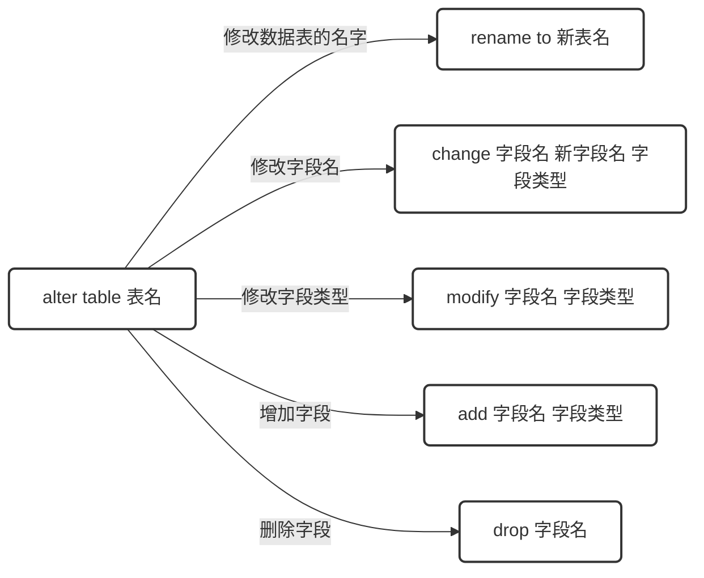

# 数据库（MySQL）

## 第一章	数据库系统概述

- DBMS：数据库管理系统

- DBS：数据库系统

- DB：数据库


关系：DBS=计算机系统(硬件、软件和人)+DBMS+DB

数据库管理技术:

1. 人工管理

2. 文件系统管理

3. 数据库系统管理

### 一、SQL简述

#### 	1.SQL的概述

​	Structure Query Language(结构化查询语言)简称SQL，它被美国国家标准局(ANSI)确定为关系型数据库语言的美国标准，后被国际化标准组织(ISO)采纳为关系数据库语言的国际标准。数据库管理系统可以通过SQL管理数据库；定义和操作数据，维护数据的完整性和安全性。

#### 	2.SQL的优点

1. 简单易学，具有很强的操作性

2. 绝大多数重要的数据库管理系统均支持SQL
3. 高度非过程化；用SQL操作数据库时大部分的工作由DBMS自动完成

#### 	3.SQL的分类

1. DDL(Data Definition Language) 数据定义语言，用来操作数据库、表、列等； 常用语句：CREATE、 ALTER、DROP

2. DML(Data Manipulation Language) 数据操作语言，用来操作数据库中表里的数据；常用语句：INSERT、 UPDATE、 DELETE
3. DCL(Data Control Language) 数据控制语言，用来操作访问权限和安全级别； 常用语句：GRANT、DENY
4. DQL(Data Query Language) 数据查询语言，用来查询数据 常用语句：SELECT

### 二、数据库的三大范式

1. 第一范式(1NF)是指数据库表的每一列都是不可分割的基本数据线；也就是说：每列的值具有原子性，不可再分割。

2. 第二范式(2NF)是在第一范式(1NF)的基础上建立起来得，满足第二范式(2NF)必须先满足第一范式(1NF)。如果表是单主键，那么主键以外的列必须完全依赖于主键；如果表是复合主键，那么主键以外的列必须完全依赖于主键，不能仅依赖主键的一部分。
3. 第三范式(3NF)是在第二范式的基础上建立起来的，即满足第三范式必须要先满足第二范式。第三范式(3NF)要求：表中的非主键列必须和主键直接相关而不能间接相关；也就是说：非主键列之间不能相关依赖。
4. BCNF，通常认为是修正的3NF，有时又称为扩充的3NF

### 三、数据类型

####   	1、整型

|   类型    | 字节数 |       无符号取值       |                   有符号取值                   |
| :-------: | :----: | :--------------------: | :--------------------------------------------: |
|  TINYINT  |   1    |         0~255          |                    -128~127                    |
| SMALLINT  |   2    |        0~65535         |                  -32768~32767                  |
| MEDIUMINT |   3    |       0~16777215       |                -8388608~8388608                |
|    INT    |   4    |      0~4294967295      |            -2147483648~ 2147483648             |
|  BIGINT   |   8    | 0~18446744073709551615 | -9223372036854775808~<br />9223372036854775808 |

#### 	2、浮点数

|  类型  | 字节数 |                      负数取值范围                      |                      非负数取值范围                      |
| :----: | :----: | :----------------------------------------------------: | :------------------------------------------------------: |
| FLOAT  |   4    |        -3.402823466E+38~-<br />1.175494351E-38         |         0和1.175494351E-38~<br />3.402823466E+38         |
| DOUBLE |   8    | -1.7976931348623157E+308~<br />2.2250738585072014E-308 | 0和2.2250738585072014E-308~<br />1.7976931348623157E+308 |

#### 	3、定点数

|              类型              |       字节数        |                      负数取值范围                      |                   非负数取值范围                   |
| :----------------------------: | :-----------------: | :----------------------------------------------------: | :------------------------------------------------: |
| DECIMAL（M,D）和DECIMAL（M,D） | M>D则M+2，M<=D则D+2 | -1.7976931348623157E+308~<br />2.2250738585072014E-308 | 0和2.2250738585072014E-308~1.7976931348623157E+308 |

#### 	4、日期时间类型

| 类型      | 字节数 | 范围                                          | 格式                      | 用途           |
| --------- | ------ | --------------------------------------------- | ------------------------- | -------------- |
| DATE      | 4      | 1000-01-01~9999-12-31                         | YYYY-MM-DD                | 日期           |
| TIME      | 3      | -838:59:59~838:59:59                          | HH:MM:SS                  | 时间值         |
| YEAR      | 1      | 1901~2155                                     | YYYY                      | 年份值         |
| DATETIME  | 8      | 1000-01-01 00:00:00~<br />9999-12-31 23:59:59 | YYYY-MM-<br />DD HH:MM:SS | 混合日期和时间 |
| TIMESTAMP | 4      | 19700101000001~<br />2038年的某一刻           | YYYYMMDD<br>HHMMSS        | 时间戳         |

#### 	5、字符串类型

| 数据类型   | 储存范围         |
| ---------- | ---------------- |
| TINYTEXT   | 0~255字节        |
| TEXT       | 0~65535字节      |
| MEDIUMTEXT | 0~16777215字节   |
| LONGTEXT   | 0~4294967295字节 |

#### 6、二进制类型

| 数据类型   | 储存范围         |
| ---------- | ---------------- |
| TINYBLOB   | 0~255字节        |
| BLOB       | 0~65535字节      |
| MEDIUMBLOB | 0~16777215字节   |
| LONGBLOB   | 0~4294967295字节 |


## 第二章	数据库与数据表基本操作

### 一、数据库的操作

#### 	1、数据库

```mysql
show databases;                                 //显示所有数据库

create database 数据库名;                       //创建一个数据库

show create database 数据库名;                  //显示创建的数据库信息

drop database 数据库名；                        //删除数据库

alter database 数据库 character set 字符集；    //修改数据库的字符集

use 数据库名；                                  //使用数据库或者切换数据库

select database();                             //查看当前使用的数据库
```


### 二、数据表的操作

#### 	1、数据表

##### 	（1）数据表的创建与查看	

- ​	create table 表名(字段1 字段类型 约束，字段2 字段类型 约束，.............，字段n 字段类型 约束)；//创建数据表
- ​	show tables;//查看当前数据库的所有表

- ​	show create table 数据表名；//查看数据表的基本信息

- ​	desc 表名； //查看数据表字段信息

##### 	（2）数据表的修改



删除数据表：

​	drop table 表名；

#### 2、数据表的约束

| 约束条件       | 说明                             |
| -------------- | -------------------------------- |
| PRIMARY KEY    | 主键约束用于唯一标识对应的记录   |
| FOREIGN KEY    | 外键约束                         |
| NOT NULL       | 非空约束                         |
| UNIQUE         | 唯一性约束                       |
| DEFAULT        | 默认值约束，用于设置字段的默认值 |
| auto_increment | 自增                             |

##### （1）主键设置

- 字段名 数据类型 primary key;
- primary key(字段名)；//单个主键
- primary key(字段名1，字段名2...)；//多个主键

##### （2）外键设置

- CONSTRAINT 外键名 FOREIGN KEY (从表外键字段) REFERENCES 主表 (主键字段)；//在创建数据表时
  ALTER TABLE 从表名 ADD CONSTRAINT 外键名 FOREIGN KEY (从表外键字段) REFERENCES 主表 (主键字段);//创建数据表创好后
- alter table 从表名 drop foreign key 外键名；//删除外键

##### （3）注意事项

- 从表里的外键通常为主表的主键
- 从表里外键的数据类型必须与主表中主键的数据类型一致
- 主表发生变化时应注意主表与从表的数据一致性问题

#### 3、修改数据

##### （1）插入数据

```mysql
INSERT INTO 表名（字段名1,字段名2,...) VALUES (值 1,值 2,...);//单条插入

INSERT INTO 表名 [(字段名1,字段名2,...)]VALUES (值 1,值 2,…),(值 1,值 2,…),...;//多条插入
```

##### （2）更新数据

```mysql
UPDATE 表名 SET 字段名1=值1[,字段名2 =值2,…] [WHERE 条件表达式];
```

##### （3）删除数据

```mysql
DELETE FROM 表名 [WHERE 条件表达式];
```

##### （4）TRUNCATE和DETELE的区别

TRUNCATE和DETELE都能实现删除表中的所有数据的功能，但两者也是有区别的：
1、DELETE语句后可跟WHERE子句，可通过指定WHERE子句中的条件表达式只删除满足条件的部分记录；但是，TRUNCATE语句只能用于删除表中的所有记录。
2、使用TRUNCATE语句删除表中的数据后，再次向表中添加记录时自动增加字段的默认初始值重新由1开始；使用DELETE语句删除表中所有记录后，再次向表中添加记录时自动增加字段的值为删除时该字段的最大值加1
3、DELETE语句是DML语句，TRUNCATE语句通常被认为是DDL语句


## 第三章	SQL查询

[]:可选项          <>：必选项

```mysql
select <*|[DISTINCT]字段名列表 [as 别名]>   --*代表所有字段，as可以定义名,DISTINCT去掉重复值
from 表名[as 别名] --数据源，数据源可以有多个  
[where <条件>] --查询条件
[group by <字段名> [HAVING <条件>]] --分组以及分组条件
[order by <字段名> [DESC]] --排序，默认升序，降序DESC
[limit row_count offset] --指定数据，row_count返回几条，从offset开始，省略为0
```

```mysql
查询语句的书写顺序
select ===> from ===> where ===> group by ===> having ===> order by ===> limit
查询语句的执行顺序
from ===> where ===> group by ===> having ===> select ===> order by ===> limit
```

### 1.字段

### 2.数据源

数据表定义别名后，可以使用别名进行访问：**别名.字段名**

#### （1）表的关联关系

- 多对一
- 多对多
- 一对一

```mysql
select * from table_name1 where 字段=(select 字段 from table_name2 where 条件)
```

#### （2）关联关系的删除数据

```mysql
delete from student where classid=(select cid from class where cname='Java');
delete from class where cname='Java';
```

#### （3）多表连接查询

##### **交叉连接查询**：

交叉连接返回的结果是被连接的两个表中所有数据行的笛卡儿积

```mysql
SELECT * FROM 表1 CROSS JOIN 表2;
```

##### **内连接查询**：

内连接(Inner Join)又称简单连接或自然连接，是一种非常常见的连接查询

```mysql
SELECT 查询字段1,查询字段2, ... FROM 表1 [INNER] JOIN 表2 ON 表1.关系字段=表2.关系字段
```

##### **外连接查询**

```mysql
SELECT 查询字段1,查询字段2, ... FROM 表1 LEFT | RIGHT [OUTER] JOIN 表2 ON 表1.关系字段=表2.关系字段 WHERE 条件
```

1. **LEFT [OUTER] JOIN** 左(外)连接：返回包括**左表中的所有记录**和右表中符合连接条件的记录。
2. **RIGHT [OUTER] JOIN** 右(外)连接：返回包括**右表中的所有记录**和左表中符合连接条件的记录。

##### **子查询**：

子查询是指一个查询语句嵌套在另一个查询语句内部的查询；该查询语句可以嵌套在一个 SELECT、SELECT…INTO、INSERT…INTO等语句中。

- exists： 它不产生任何数据只返回TRUE或FALSE
- any：表示满足其中任意一个条件
- all：满足所有内层査询条件

### 3.条件

#### （1）运算符

| 关系运算符 |   说明   |
| :--------: | :------: |
|     =      |   等于   |
|     <>     |  不等于  |
|     !=     |  不等于  |
|     <      |   小于   |
|     <=     | 小于等于 |
|     >      |   大于   |
|     >=     | 大于等于 |

#### （2）in,is null和between...and...

- **in**:判断某个字段的值是否在指定集合中
- **is null**:判断字段的值是否为空值
- **between...and**:判断某个字段的值是否在指定的范围之内

#### （3）多个条件之间的连接

- **and**：同时满足
- **or**：满足一个
- **not**：否定

#### （4）Like

- **%**:任意数量的任意字符
- **_**:单个字符

#### 4.分组

GROUP BY 子句可像切蛋糕一样将表中的数据进行分组，再进行查询等操作

```mysql
1.GROUP BY和聚合函数一起使用
select count(*), departmentnumber from employee group by departmentnumber;
2.GROUP BY和聚合函数以及HAVING一起使用
select sum(salary),departmentnumber from employee group by departmentnumber having sum(salary)>8000;
```

#### 5.排序

**排序可以多个字段，用逗号分隔，顺序从左到右依次排序**


## 第四章	正则表达式

### 一、操作符

|    模式    |                             描述                             |
| :--------: | :----------------------------------------------------------: |
|     ^      | 匹配输入字符串的开始位置。如果设置了 RegExp 对象的 Multiline 属性，^ 也匹配 '\n' 或 '\r' 之后的位置。 |
|     $      | 匹配输入字符串的结束位置。如果设置了RegExp 对象的 Multiline 属性，$ 也匹配 '\n' 或 '\r' 之前的位置。 |
|     .      | 匹配除 "\n" 之外的任何单个字符。要匹配包括 '\n' 在内的任何字符，请使用像 '[.\n]' 的模式。 |
|   [...]    | 字符集合。匹配所包含的任意一个字符。例如， '[abc]' 可以匹配 "plain" 中的 'a'。 |
|   [^...]   | 负值字符集合。匹配未包含的任意字符。例如， '[^abc]' 可以匹配 "plain" 中的'p'。 |
| p1\|p2\|p3 | 匹配 p1 或 p2 或 p3。例如，'z\|food' 能匹配 "z" 或 "food"。'(z\|f)ood' 则匹配 "zood" 或 "food"。 |
|     *      | 匹配前面的子表达式零次或多次。例如，zo* 能匹配 "z" 以及 "zoo"。* 等价于{0,}。 |
|     +      | 匹配前面的子表达式一次或多次。例如，'zo+' 能匹配 "zo" 以及 "zoo"，但不能匹配 "z"。+ 等价于 {1,}。 |
|    {n}     | n 是一个非负整数。匹配确定的 n 次。例如，'o{2}' 不能匹配 "Bob" 中的 'o'，但是能匹配 "food" 中的两个 o。 |
|   {n,m}    | m 和 n 均为非负整数，其中n <= m。最少匹配 n 次且最多匹配 m 次。 |

### 二、正则表达式匹配的字符类

- `.`：匹配任意单个字符。
- `^`：匹配字符串的开始。
- `$`：匹配字符串的结束。
- `*`：匹配零个或多个前面的元素。
- `+`：匹配一个或多个前面的元素。
- `?`：匹配零个或一个前面的元素。
- `[abc]`：匹配字符集中的任意一个字符。
- `[^abc]`：匹配除了字符集中的任意一个字符以外的字符。
- `[a-z]`：匹配范围内的任意一个小写字母。
- `[0-9]`：匹配一个数字字符。
- `\w`：匹配一个字母数字字符（包括下划线）。
- `\s`：匹配一个空白字符。

### 三、用REGEXP（/RLIKE）进行模式匹配

REGEXP 是用于进行正则表达式匹配的运算符。

REGEXP 用于检查一个字符串是否匹配指定的正则表达式模式，以下是 REGEXP 运算符的基本语法：

```mysql
SELECT column1, column2, ...  #是你要选择的列的名称，如果使用 * 表示选择所有列
FROM table_name     #是你要从中查询数据的表的名称
WHERE column_name   #是你要进行正则表达式匹配的列的名称
REGEXP 'pattern';    #是一个正则表达式模式
```


## 第五章	索引与视图

### 一、索引

#### 1.什么是索引

索引是一种特殊的文件，用来快速查询数据库表中的特定记录。

#### 2.索引的特点

- 索引是存放在模式（schema）中的一个数据库对象
- 索引在数据库中用来加速对表的查询
- 通过使用快速路径访问方法快速定位数据,减少了磁盘的I/O
- 索引与表独立存放，但不能独立存在，必须属于某个表
- 索引由数据库自动维护，表被删除时，该表上的索引自动被删除

#### 3.索引分类

（1）按照算法分类

- Hash索引
- B+Tree索引

（2）按照功能分类

- 单列索引：一个索引只包含单个列，但一个表中可以有多个单列索引

- 普通索引INDEX：加速查找，最常用的索引，允许重复
- 主键索引PRIMARY KEY：加速查找+约束（不为空、不能重复）
- 唯一索引UNIQUE：加速查找+约束（不能重复）
- 全文索引（FULLTEXT）：仅可用于 MyISAM 表，建立于char字段

#### 4.索引的优缺点

（1）优点

- 提高检索数据的速度
- 对于联合查询，可以提高查询速度
- 使用分组和排序子句进行数据查询时，同样可以显著节省查询中分组和排序的时间

（2）缺点

- 创建和维护索引需要耗费时间
- 索引需要占用一定的磁盘空间
- 增删改查数据时，要动态维护索引，会降低数据的维护速度

#### 5.索引怎么设计

- 选择惟一性索引

- 为经常需要排序、分组和联合操作的字段建立索引
- 为常作为查询条件的字段建立索引
- 限制索引的数目
- 尽量使用数据量少的索引
- 尽量使用字段前缀来索引，即限制索引长度，索引长度：对表中特定字段的前N个字符创建索引。通常用于减少索引的大小，并且可以提高查询性能
- 删除不再使用或者很少使用的索引

#### 6.创建索引

（1）在新建数据表时创建索引

```mysql
create table 表名 (
    字段名1 数据类型 [完整性约束条件…],
    字段名2 数据类型 [完整性约束条件…],
    [unique | fulltext | spatial] index | key
    [索引名] (字段名[(长度)] [asc | desc])
);
```

（2）数据表已经存在，建立索引

```mysql
create [unique | fulltext | spatial] 
index 索引名 ON 表名 ( 字段名[(长度)] [asc | desc] );
```

（3）使用alter table语句来创建索引

```mysql
alter table 表名 add [unique | fulltext | spatial] 
index  索引名 (字段名[(长度)] [asc | desc]);
```

#### 7.查看索引

```mysql
···查询索引···
show create table 表名
···查询某张表中的索引情况···
show index from 表名
···使用计划查询SQL使用索引情况···
explain select * from 表名 where 条件
···使用系统表查看所有索引···
select * from mysql.'innodb_index_stats' a where a.'database_name' = '数据库名';
```


#### 8.删除索引

```mysql
drop index 索引名 on 表名;
```

### 二、视图（view）

#### 1.视图是什么

- 视图是一种虚拟表，其内容由查询定义，视图本身并不包含数据。
- 视图看起来和真实的表完全相同，但其中的数据来自定义视图时用到的基本表，并在打开视图时动态生成，类似对常用的复杂多表连接查询的结果截图拍照，之后需要使用时只需要看一下视图即可无需重新查询，以节省资源。
- 视图时一种数据库对象，只是一种查询，其内没有数据

#### 2.视图的作用和优点

（1）作用

- 控制安全
- 保存查询数据

（2）优点

- 简化操作
- 提高数据的安全性
- 数据独立

#### 3.创建视图

```mysql
create [or replace] [algorithm = {undefined | merge | temptable}]
view view_name [(column_list)]
as select_statement
[with [cascaded | local] check option]
```


注意

1、or replace：如果要创建的视图名称已存在，则替换已有视图。

2、algorithm：可选参数，表示视图选择的算法，默认算法是 undefined

- undefined：未定义指定算法
- merge:更新视图表数据的同时会更新真实表的数据
- temptable:只能查询不能更新

3、view_name：新建的视图名称。

4、column_list：可选，表示视图的字段列表。若省略，则使用 select 语句中的字段列表。

5、as select_statement：创建视图的 select 语句。

6、with check option：表示更新视图时要保证该视图的 where 子句为真。比如定义视图：create view v1 as select * from salary > 5000;如果要更新视图，则必须保证 salary 字段的值在 5000 以上，否则报错。

- cascaded:必须满足所有针对该视图的条件才可以更新
- local:只需满足本视图的条件就可以更新
  

#### 4.更新视图

以下视图不可更新：

- 包含以下关键字的 SQL 语句：聚合函数、distinct、group by 、having、union 或 uinon all
- select 中包含子查询
- from 一个不可更新的试图
- where 子句的子查询引用了 from 子句中的表

#### 5.视图使用规则

- 视图必须有唯一命名
- 在mysql中视图的数量没有限制
- 创建视图必须从管理员那里获得必要的权限
- 视图支持嵌套，也就是说可以利用其他视图检索出来的数据创建新的视图
- 在视图中可以使用order by，但是如果视图内已经使用该排序子句，则视图的order by将覆盖前面的order by
- 视图不能索引，也不能关联触发器或默认值
- 视图可以和表同时使用

#### 6.修改和查看视图

##### （1）重建或修改视图

```mysql
1.create or replace view view_name [(column_list)] as select_statement

2.alter view view_name[(column_list)] as select_statement
```

##### （2）查看视图

```mysql
1.describe/desc view_name  

2.show table status like 'view_name' 

3.show create view view_name
```

#### 7.删除视图

drop view [if exists] view_name;


## 第六章	MySQL存储过程和函数

### 一、存储过程的概述

**存储过程**：（PROCEDURE）是事先经过编译并存储在数据库中的一段SQL语句的集合。调用存储过程可以简化应用开发人员的很多工作，减少数据在数据库和应用服务器之间的传输，对于提高数据处理的效率是很有好处的。

**就是数据库SQL语言成面的代码封装与重用。**

存储过程就类似于Java中的方法，需要先定义，使用时需要调用。存储过程可以定义参数，参数分为**IN、OUT、INOUT**类型三种类型。

1. IN类型的参数表示接受调用者传入的数据；
2. OUT类型的参数表示向调用者返回数据；
3. INOUT类型的参数即可以接受调用者传入的参数，也可以向调用者返回数据。

#### 优缺点

##### （1）优点

- 简化了复杂操作
- 简化对变动的管理
- 有助于提高应用程序的性能
- 减少应用程序和数据库服务器之间的流量
- 存储过程度任何应用程序都是可重用的和透明的
- 存储的程序是安全的

##### （2）缺点

- 如果使用大量的存储过程，那么使用这些存储过程的每个连接的内存使用量将大大增加
- 存储过程的构造使得开发具有了复杂的业务逻辑的存储过程变得困难
- 很难调试存储过程
- 开发和维护存储过程都不容易
- 对数据库依赖程度较高，移值性差

### 二、存储过程的定义

#### 1.基本语句格式

```mysql
DELIMITER $$

CREATE
    [DEFINER = { user | CURRENT_USER }]
    PROCEDURE 数据库名.存储过程名([in变量名 类型,out 参数 2，...])
    //*LANGUAGE SQL
    | [NOT] DETERMINISTIC
    | { CONTAINS SQL | NO SQL | READS SQL DATA | MODIFIES SQL DATA }
    | SQL SECURITY { DEFINER | INVOKER }
    | COMMENT 'string'*//
	BEGIN
		[DECLARE 变量名 类型 [DEFAULT 值];]
		存储过程的语句块;
	END$$

DELIMITER ;
```

1.存储过程中的参数分别是 in，out，inout三种类型

- in代表输入参数
- out代表输出参数
- inout代表即时输入参数，又是输出参数

2.存储过程中的语句必须包含在BEGIN和END之间。

3.DECLARE中用来声明变量，变量默认赋值使用的DEFAULT，语句块中改变变量值，使用SET 变量=值；

#### 2.调用存储过程

CALL 过程名();

#### 3.定义流程控制语句IF ELSE

与编译语言的if..else一样的用法

#### 4.定义一个条件控制语句 CASE

case是另一个条件判断的语句，类似于编程语言中的 choose、when语法。MySQL 中的**case语句**有两种语法格式。

**第一种**

```mysql
DELIMITER $$
CREATE 
    PROCEDURE demo4(IN num INT)
	BEGIN
		CASE -- 条件开始
	WHEN num<0 THEN 
		SELECT '负数';
	WHEN num>0 THEN 
		SELECT '正数';
	ELSE 
	SELECT '不是正数也不是负数';

	END CASE; -- 条件结束
	END$$
DELIMITER;
```
**第二种**

```mysql
DELIMITER $$
CREATE 
    PROCEDURE demo5(IN num INT)
	BEGIN
		CASE num  -- 条件开始
		WHEN 1 THEN 
			SELECT '输入为1';
		WHEN 0 THEN 
			SELECT '输入为0';
		ELSE 
		SELECT '不是1也不是0';
		END CASE; -- 条件结束
	END$$
DELIMITER;
```
#### 5.定义一个循环语句WHILE

```mysql
DELIMITER $$
CREATE 
    PROCEDURE demo6(IN num INT,OUT SUM INT)
	BEGIN
	     SET SUM = 0;
	     WHILE num<10 DO -- 循环开始
	         SET num = num+1;
	         SET SUM = SUM+num;
	         END WHILE; -- 循环结束
	END$$
DELIMITER;
```
#### 6.定义一个循环语句REPEAT UNTLL

```mysql
-- 创建过程
DELIMITER $$
CREATE 
    PROCEDURE demo7(IN num INT,OUT SUM INT)
	BEGIN
	     SET SUM = 0;
	     REPEAT-- 循环开始
		SET num = num+1;
		SET SUM = SUM+num ;
		UNTIL num>=10
		END REPEAT; -- 循环结束
	END$$
DELIMITER;
```

#### 7.定义循环语句LOOP

循环语句，用来重复执行某些语句。

执行过程中可使用 LEAVE语句或者ITEREATE来跳出循环，也可以嵌套IF等判断语句。

- LEAVE 语句效果对于Java中的break，用来终止循环；

- ITERATE语句效果相当于Java中的continue，用来跳过此次循环。进入下一次循环。且ITERATE之下的语句将不在进行。

```mysql
DELIMITER $$
CREATE 
    PROCEDURE demo8(IN num INT,OUT SUM INT)
	BEGIN
	     SET SUM = 0;
	     demo_sum:
	     LOOP-- 循环开始
		SET num = num+1;
		IF num > 10 THEN
		    LEAVE demo_sum; -- 结束此次循环
		ELSEIF num <= 9 THEN
		    ITERATE demo_sum; -- 跳过此次循环
		END IF;
		SET SUM = SUM+num;
		END LOOP demo_sum; -- 循环结束
	END$$
DELIMITER;
```

#### 8.使用存储过程插入信息

```mysql
DELIMITER $$
CREATE 
    PROCEDURE demo9(IN s_student VARCHAR(10),IN s_sex CHAR(1),OUT s_result VARCHAR(20))
	BEGIN
	   -- 声明一个变量 用来决定这个名字是否已经存在
	   DECLARE s_count INT DEFAULT 0;
	   -- 验证这么名字是否已经存在
	   SELECT COUNT(*) INTO s_count FROM student WHERE `name` = s_student;	
	   IF s_count = 0 THEN
	        INSERT INTO student (`name`, sex) VALUES(s_student, s_sex);
		SET s_result = '数据添加成功';
	   ELSE
                SET s_result = '名字已存在，不能添加';
                SELECT s_result;
	   END IF;
	END$$
DELIMITER;
```

### 三、存储过程的管理

#### 1.显示存储过程

```mysql
SHOW PROCEDURE STATUS;
select name from mysql.proc where db='数据库名';
```

#### 2.修改存储过程

```mysql
Alter PROCEDURE sp_name
```

#### 3.显示特定数据库的存储过程

```mysql
SHOW PROCEDURE STATUS WHERE db = 'db名字' AND NAME = 'name名字';
```

#### 4.显示特定模式的存储过程

```mysql
SHOW PROCEDURE STATUS WHERE NAME LIKE '%mo%';
```

#### 5.显示存储过程的源码

```mysql
SHOW CREATE PROCEDURE 存储过程名;
```

#### 6.删除存储过程

```mysql
DROP PROCEDURE 存储过程名;
```


## 第七章	触发器

### 一、概念

1. 触发器是一种**特殊的存储过程**，它在插入、删除或修改特定表中的数据时触发执行。
2. 由用户定义在**关系表**上的一类由**事件驱动**的**特殊过程**，执行一些**自动的数据操作**。

#### 1.作用

- 安全性
- 审计
- 实现复杂的数据完整性规则
- 实现复杂的非标准的数据库相关完整性规则

#### 2.为什么使用触发器

可以实现数据约束，数据验证，数据复制等功能。

### 二、创建触发器

```mysql
create trigger 触发器名 
{before|after}{insert|update|delete}  --触发器类型和事件
on 表名
for each row   --触发器的作用范围
begin
	--触发器执行的操作
end;
```

- before / after ： 表示触发器的类型，分别表示发生前/发生后执行
- insert / update / delete ： 表示触发器的事件类型，分别表示插入 / 更新 / 删除操作
- for each row ： 表示触发器作用的范围，即每一行记录都会触发该触发器

| 触发器 | new与old |
| :----: | :------: |
| insert |   new    |
| update | new、old |
| delete |   old    |


注意：

触发器是自动执行的，无需手动调用。

### 三、删除触发器

```mysql
drop trigger 触发器名;
```

### 四、应用场景

1. 强制实施业务规则

2. 记录日志变更
3. 复杂的默认值计算
4. 数据同步
5. 数据校验


## 第八章	用户与权限管理

### 一、概述

MySQL的权限简单的理解就是MySQL允许你做你权利以内的事情，不可以越界。[MySQL服务](https://so.csdn.net/so/search?q=MySQL服务&spm=1001.2101.3001.7020)器通过权限表来控制用户对数据库的访问，权限表存放在mysql数据库中，由mysql_install_db脚本初始化。

### 二、用户管理

#### 1、用户信息

- host： 表示这个用户可以从哪个主机登陆，如果是localhost，表示只能从本机登陆
- user： 用户名
- authentication_string： 用户密码通过password函数加密后的
- *_priv： 用户拥有的权限

#### 2、创建用户

```mysql
create user '用户名'@'登陆主机/ip' identified by '密码';
创建之后需要刷新
flush privileges;
```

#### 3、删除用户

```mysql
drop user '用户名'@'主机名'
delete  from mysql.user where host='hostname' and user='username'
```

#### 4、修改密码

```mysql
update mysql.user set authentication_string =password(密码) where host='hostname' and user='username'
自己改自己密码：
set password=password('新的密码');
改其他用户的密码：
set password for '用户名'@'主机名'=password('新的密码')；
```

### 三、权限管理

#### 1、概念

1. 可以限制用户访问哪些库、哪些表
2. 可以限制用户对哪些表执行SELECT、CREATE、DELETE、DELETE、ALTER等操作
3. 可以限制用户登录的IP或域名
4. 可以限制用户自己的权限是否可以授权给别的用户

权限管理的两个阶段：

1. 有没有权限连接上来
2. 有没有权限执行本操作

**操作执行权限**
mysql数据库(系统数据库)下的表：user、db、tables_priv、columns_priv、proce_priv、proxies_priv共同构成授权表；

#### 2、给用户授权

```mysql
语法：
grant [权限1,权限2,权限3] on *.* to user@'host' identified by 'password'

例如，给"zhangsan" 用户管理员权限，并且允许该用户继续给别的用户赋权限
grant all privileges on *.* to 'zhangsan'@'192.168.1.%' with grant option;

说明：
all privileges：表示将所有权限授予给用户。也可指定具体的权限，如：SELECT、CREATE、DROP等。
on：表示这些权限对哪些数据库和表生效，格式：数据库名.表名，这里写“*”表示所有数据库，所有表。
	如果我要指定将权限应用到test库的user表中，可以这么写：test.user
to：将权限授予哪个用户。格式：”用户名”@”登录IP或域名”。%表示没有限制，在任何主机都可以登录
with grant option：允许被授权的用户把得到的权限继续授给其它用户
identified by可选： 如果用户存在，赋予权限的同时修改密码,如果该用户不存在，就是创建用户

注：使用GRANT添加权限，权限会自动叠加，不会覆盖之前授予的权限
授权之后进行刷新
flush privileges
```

#### 3、回收权限

```mysql
语法：
revoke 权限列表 on 库.对象名 from '用户名'@'登陆位置'；
```


## 第九章	数据库备份与还原

### 一、备份

#### 1、数据备份的重要性

数据备份的主要目的时灾难恢复。

在生产环境中，数据的安全性至关重要，任何数据的丢失都有可能产生严重的后果。

造成数据丢失的原因：

- 程序错误
- 人为操作错误
- 运算错误
- 磁盘故障
- 灾难(如火灾、地震)和盗窃

先备份再恢复

#### 2、数据备份分类

##### 2.1、物理备份

对数据库操作系统的物理文件(如数据文件、日志文件等)的备份

物理备份的方法：

- 冷备份(脱机备份):是在关闭数据库的时候进行的；
- 热备份(联机备份):数据库处于运行状态，依赖于数据库的日志文件；
- 温备份:数据库锁定表格(不可写入但可读)的状态下进行备份操作。

##### 2.2、逻辑备份

对数据库的表或者对象进行备份。

#### 3、数据库备份测策略

1. 完全备份：每次备份都备份完整的数据库
2. 差异备份：只备份上一次完全备份后的更新数据
3. 增量备份：每次备份只备份上一次完全备份或增量备份后的更新数据

## 第十章	特殊查询语句

### 1.把表结构输出出来

```mysql
select	
    column_name as 字段名称,
    column_type as 数据类型，
    if(column_key = 'PRI','Y','N') as 主键，
    if(is_nullable='no','Y','N') as 非空,
    column_comment as 注释
from
	information_schema.columns
where
	table_schema='XXX'   --数据库
and
	table_name='XXX'  --表
```

### 2.查找指定位置（分页查找）

```mysql
select * from table limit n,m;
--table 表明
--n 跳过n条数据
--m 查找m条数据
```

